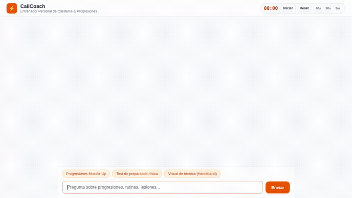

# CaliCoach ⚡

**Entrenador Personal y Asistente de Progresiones de Calistenia impulsado por Gemini y Agent Platform**

CaliCoach es un agente conversacional inteligente diseñado para guiar a atletas en el dominio de movimientos corporales avanzados (Muscle-Up, Handstand, Front Lever, Planche, etc.), evaluar su preparación física mediante prerrequisitos biomecánicos, registrar sesiones de entrenamiento y generar visuales técnicos de alineación articular.



---

## 🎯 Capacidades Implementadas

El agente está construido sobre el Google Agent Development Kit (ADK) y cuenta con las siguientes capacidades conectadas en código:

- **Memoria a Largo Plazo (Vertex AI Memory Bank)**:
  - Recupera automáticamente preferencias del atleta, marcas personales (PRs en dominadas y fondos), historial de lesiones o limitaciones articulares (muñecas, hombros) y todas las alergias del usuario mediante `PreloadMemoryTool`.
  - Persiste nuevos recuerdos y observaciones tras cada conversación a través de un callback `generate_memories_callback` configurado con el servicio `agentengine://`.

- **Base de Datos de Habilidades y Entrenamientos (Google Cloud Firestore)**:
  - `list_calisthenics_skills`: Consulta el catálogo de habilidades, niveles y progresiones almacenadas en la colección `calisthenics_skills`.
  - `get_skill_progression`: Extrae detalles técnicos, requisitos de seguridad articular y progresiones previas.
  - `assess_skill_readiness`: Evalúa cuantitativamente si el atleta cuenta con la base de fuerza mínima requerida (ej. número de dominadas y fondos estrictos) antes de iniciar el trabajo de una habilidad avanzada.
  - `log_workout_session` & `get_recent_workouts`: Registra entrenamientos realizados (fecha, ejercicios, series, reps, RPE, notas) y consulta el historial reciente en la colección `workout_logs`.

- **API Externa de Ejercicios Auxiliares**:
  - `search_external_exercises`: Consulta la base pública de *Free Workout & Exercise API* para traer información anatómica, músculos secundarios y variaciones con peso corporal o equipamiento auxiliar.

- **Generación Visual y Almacenamiento (Vertex AI Imagen + Cloud Storage)**:
  - `generate_exercise_visual`: Genera ilustraciones de alineación técnica y posturas corporales usando el modelo `gemini-3.1-flash-lite-image` en la región global de Vertex AI.
  - Guarda la imagen en los artefactos de la sesión (`tool_context.save_artifact`) y la sube automáticamente a un bucket público de Google Cloud Storage (`calicoach-assets-...`), devolviendo una URL HTTPS pública directa.

- **Ejecución Segura de Código en la Nube (Agent Engine Sandbox)**:
  - Utiliza `AgentEngineSandboxCodeExecutor` conectado al entorno de sandbox de Vertex AI Agent Engine para ejecutar código Python aislado cuando se requieren cálculos numéricos de volumen de entrenamiento, porcentajes de sobrecarga progresiva o balances de empuje/tirón.

- **Interfaz Gráfica A2UI (Agent to UI v0.8)**:
  - Instrucciones del sistema y formateador de respuesta (`a2ui_callback`) para emitir tarjetas interactivas de calistenia (`Card`, `Column`, `Row`, `Text`, `Image`) compatibles con el protocolo A2A y renderizadas en la interfaz web.

- **Frontend Ligero de Chat con Cronómetro**:
  - Servidor proxy FastAPI que se comunica con el agente mediante el protocolo A2A.
  - Interfaz web con diseño optimizado, avatares, barra de prompts rápidos y cronómetro / temporizador de descanso de series integrado (60s, 90s, 3m).

---

## 🏗️ Arquitectura de Servicios de Google Cloud

| Servicio | Rol en el Proyecto | Implementado en |
| :--- | :--- | :--- |
| **Gemini 2.5 Flash** | Modelo principal de razonamiento y orquestación | `app/agent.py` |
| **Gemini 3.1 Flash Lite Image** | Generación de visuales técnicos de ejercicios | `app/agent.py` (`generate_exercise_visual`) |
| **Vertex AI Agent Engine** | Despliegue del runtime del agente y servicio de memoria | `agents-cli-manifest.yaml` |
| **Agent Engine Sandbox** | Aislamiento y ejecución segura de código Python | `app/agent.py` (`AgentEngineSandboxCodeExecutor`) |
| **Cloud Firestore** | Almacén persistente de catálogo de habilidades y sesiones | `app/agent.py` (`db = firestore.Client(...)`) |
| **Google Cloud Storage** | Hospedaje y distribución pública de imágenes de técnica | `app/agent.py` (`storage.Client(...)`) |
| **Cloud Run** | Hospedaje del frontend web y proxy A2A | `calicoach-frontend` |

---

## 🚀 Guía de Ejecución Local

### 1. Requisitos Previos

- Python 3.11+ con `uv` instalado.
- Credenciales de Google Cloud configuradas (`gcloud auth application-default login`).
- Proyecto de GCP activo con las APIs de Vertex AI, Firestore y Cloud Storage habilitadas.

### 2. Probar el Agente en ADK Web Playground

Para iniciar el entorno de desarrollo del ADK con el servicio de memoria activado:

```bash
cd calicoach
uv run adk web . --port 8080 --reload_agents --memory_service_uri=agentengine://<AGENT_ENGINE_ID>
```

### 3. Ejecutar el Frontend Web Localmente

El frontend reside en el directorio `frontend/` y se conecta al agente mediante el protocolo A2A:

```bash
cd calicoach/frontend

# 1. Crear entorno e instalar dependencias
uv venv .venv
uv pip install -r requirements.txt --python .venv/bin/python

# 2. Configurar variables de entorno
export AGENT_ENGINE_RESOURCE_NAME="projects/<PROJECT_NUMBER>/locations/<REGION>/reasoningEngines/<AGENT_ENGINE_ID>"
export AGENT_DIRECTORY="app"

# 3. Iniciar el servidor FastAPI
.venv/bin/python main.py
```

### 4. Ejecutar Pruebas Automatizadas

El agente incluye un conjunto de pruebas unitarias que verifican la inicialización de herramientas, catálogo y callbacks:

```bash
cd calicoach
uv run pytest tests/test_agent.py
```
